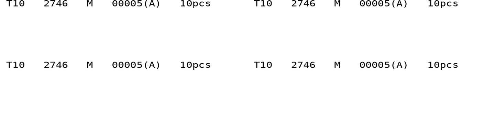

# 菲纸打印程序 v0.5

[下载 v0.5 压缩包](https://github.com/shenlinzia/my-first-project/raw/refs/heads/ticket-download-v0.1/downloads/FEIPRINT-test-v0.5.zip)

每个码数按输入顺序对应 A 到 L。例：S M M 分别对应 S(A)、M(B)、M(C)。每张菲纸左右两栏、上下各两条，共四条相同信息。输出示例：

```text
T10   2746   M   00005(A)   10pcs
```

字段之间通常为三个空格。字段总长度较大时，程序自动减少空格，保证每条内容放入半张。字母由码数位置决定，重复码独立计算。

本次使用 v0.4 的普通草稿字体、普通字高和普通字重。有关放大字体的可选方式还在讨论；v0.3 出现过异常慢和尖锐声，无法仅凭照片确定具体原因。

输入页面标识 v0.5；首页款号最多8字符，整张份数默认2。按↑返回上一项，F2修改首页，F10确认退出；新匝的件数空回车沿用上一匝。流程与 v0.4 一致。

解压到新的文件夹，SAMPLE.BAT 只发送一张样纸，START.BAT 正式录入。云端DOS核对了A至L、重复码、最长内容和每张四条一致；未在实体打印机上试打。



ZIP SHA256: `7c17b8befeb03c34e73e41afad9674600b7660ddee2f82baea10b37c36505635`

此前版本：[v0.4](FEIPRINT-test-v0.4.zip)、[v0.3](FEIPRINT-test-v0.3.zip)、[v0.2](FEIPRINT-test-v0.2.zip)、[v0.1](FEIPRINT-test-v0.1.zip)。
