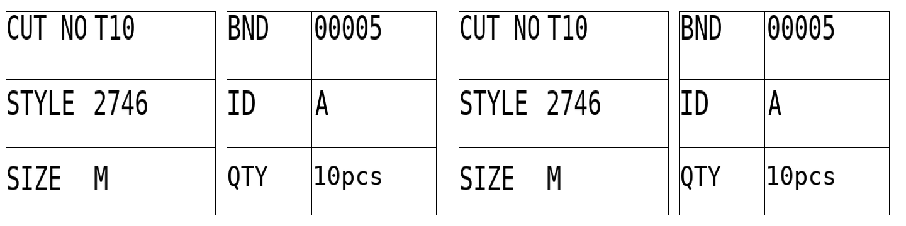

# 菲纸打印程序 v0.6 方框试打版

[下载 v0.6 试打包](https://github.com/shenlinzia/my-first-project/raw/refs/heads/ticket-download-v0.1/downloads/FEIPRINT-test-v0.6.zip)

每张左右两半内容相同；每半左右两组方框，每组三行。左组是 CUT NO（床号）、STYLE（款号）、SIZE（码数），右组是 BND（扎号）、ID（码数序号）、QTY（件数）。码数按输入位置分配 A～L，相同码数也分别分配。

本图只示意内容和位置；打印机机内字体、方框、走纸和纸张上的位置需实机确认。上图是一整张，左右两半相同。

程序选择普通字重并启用倍高倍宽。为将8字符款号放入方框，采用压缩基础字距后再倍宽；相对于v0.5普通字距，字符间距约宽17%，不是两倍宽。画框也增加打印工作，实际速度和声音未测。

解压到新文件夹，先运行 SAMPLE.BAT，只发送一张。检查框线、位置和声音；如果有尖锐异响、明显异常慢或报错，请停止试打，先用原正常版本。样纸正常后运行 START.BAT，先用一床、一码、一匝、一份测试。界面标识 v0.6，整张份数默认2，可改1～3。

保留按↑回退、F2修改首页、F10确认退出，码数最多12个、匝数最多30，后续新匝件数可空回车沿用上匝；每床后床号递增，扎号回到设定起点。

16位DOS已核对样纸、重复尺码、A～L序号、最长字段和2英寸走纸数据，另用DOSBox-X打印机模拟器渲染检查；没有连接用户实体打印机。

ZIP SHA-256: `0a21ca7544a3eb2f73e37d62ca2b773582e2cc83cdb2b9f10f3e968e151e5505`

[旧版本 v0.5](FEIPRINT-test-v0.5.zip) · [v0.4](FEIPRINT-test-v0.4.zip) · [v0.3](FEIPRINT-test-v0.3.zip)
