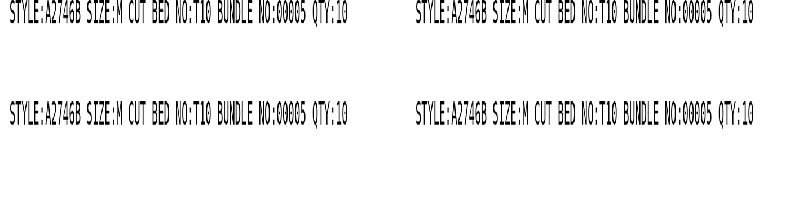
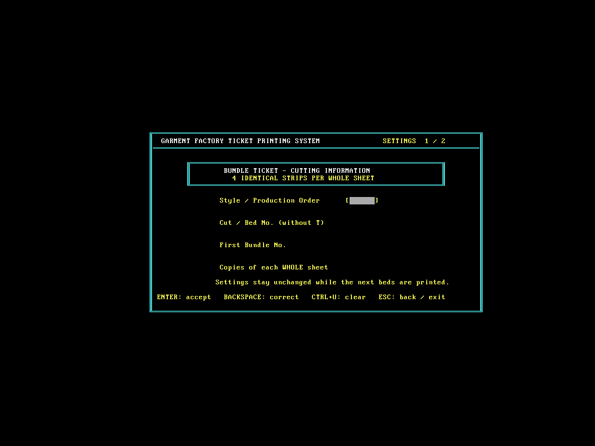
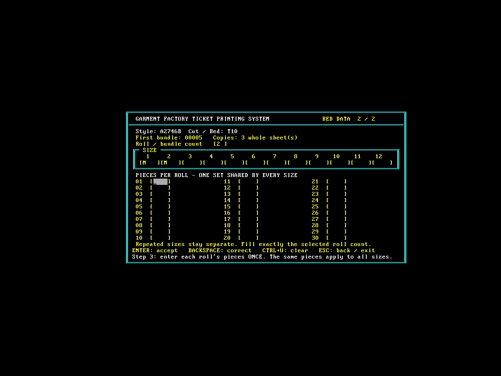

# 菲纸打印程序：纯字符旧系统试打版 v0.3

**[下载最新版 v0.3 ZIP](https://github.com/shenlinzia/my-first-project/raw/refs/heads/ticket-download-v0.1/downloads/FEIPRINT-test-v0.3.zip)**

解压到新文件夹，在原来的旧电脑上先运行 SAMPLE.BAT 打一张，再运行 START.BAT，用一个尺码、一扎、一份试打。沿用原有LPT1连接。

## 新输出

每张分左右两栏，每栏上下两条，共四条完全相同：

```text
STYLE:A2746B SIZE:M CUT BED NO:T10 BUNDLE NO:00005 QTY:10
```

QTY是数量。货期已从打印和首页输入中取消。

- 采用EPSON内置英文字符、普通字重；关闭粗体和双击，只放大字高。
- 完整英文标签较长，字宽收紧以适应每半张；最长64字符可放入每栏。
- 不发点阵图形，固定样纸输出293字节（v0.2为31145）。数据减少99.06%，实际速度需实机试打。
- 保留画框界面、扎数先录、12个大写尺码、30扎上限、一组各扎件数共享、床号自动加1与每床扎号回到设定起点。

已在真实DOS环境完成连续两床15张60条记录核对，每张4条相同；最长字段和16位业务边界测试通过。v0.2的已捕获首张与样纸相同，未据此确定实机闪红灯根因；新版红灯是否消除仍需复测。若仍报错，请记录具体灯名、蜂鸣以及是否已打印第一行。

### 字符布局示意

实机使用机内字形，本图只示意内容与位置，不是打印照片。



### 首页和录入页





ZIP SHA-256: `66ccde13c2d133ccdd3749b8fc7ce0a831cb84d84b168a9b949dd2b7d2206f4e`

旧版本：[v0.2](FEIPRINT-test-v0.2.zip)、[v0.1](FEIPRINT-test-v0.1.zip)。
