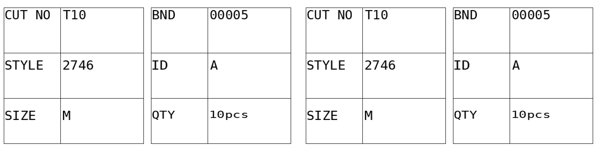

# 菲纸打印程序 v0.7 方框普通字体版

[下载 v0.7 压缩包](https://github.com/shenlinzia/my-first-project/raw/refs/heads/ticket-download-v0.1/downloads/FEIPRINT-test-v0.7.zip)

**打印机恢复前请勿运行本包。** 用户反馈 v0.6 出现尖锐声音和红灯，原因未确定。请先关闭打印机和菲纸软件，取消该打印机队列里的残留任务，并确认原软件能正常打印。

v0.7 保留每张左右两半相同的六项方框，左组 CUT NO / STYLE / SIZE，右组 BND / ID / QTY。码数按输入位置分配 A～L，重复码也分别分配。

本版取消倍高、倍宽和压缩字距，使用普通字高、普通字距和普通字重；字体比 v0.6 小。为了保留方框，本版仍发送画线图形数据，不能保证尖锐声音或红灯不会再次出现；没有在用户实体打印机上试打。

恢复原版正常打印后，如决定测试，先只运行 SAMPLE.BAT 打一张；如出现尖锐声、红灯或异常慢，立即停止并关机。样纸正常后，再用 START.BAT 录入，建议先一床、一码、一匝、一份。界面标识 v0.7，整张份数默认2，可改1～3。

云端DOS已核对重复尺码、A～L、最长字段、两半相同和2英寸进纸数据，另经打印机模拟器检查。v0.5、v0.4仍留在此下载分支。

ZIP SHA-256: `ef0f69d5b5305a323ae0054952685c810cdf14e11b0b74c6edd679e2b39107f4`

[旧版本 v0.5](FEIPRINT-test-v0.5.zip) · [v0.4](FEIPRINT-test-v0.4.zip)
