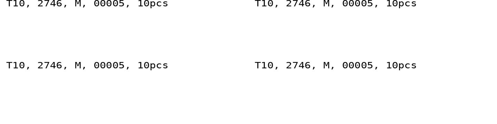
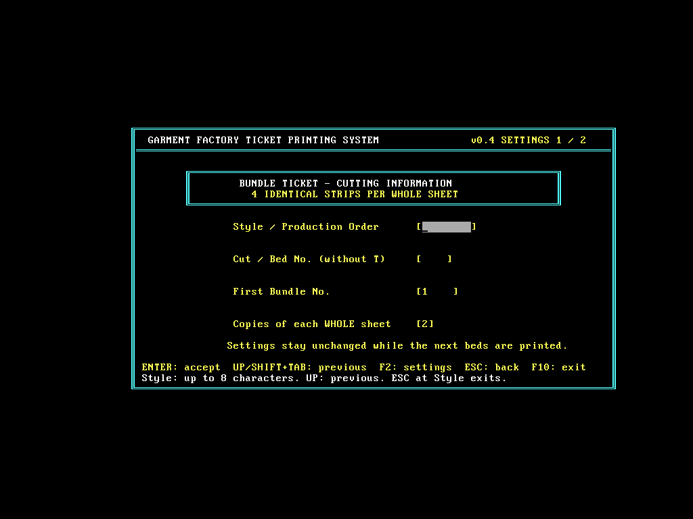
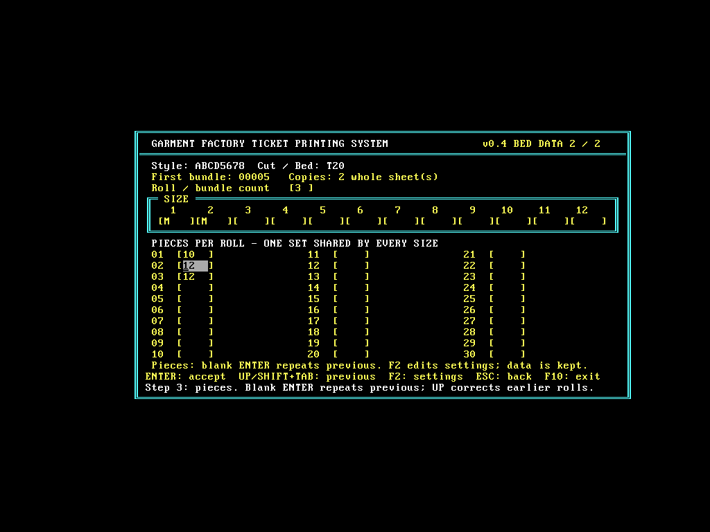

# 菲纸打印程序 v0.4：简短字符版

**[下载 v0.4 ZIP](https://github.com/shenlinzia/my-first-project/raw/refs/heads/ticket-download-v0.1/downloads/FEIPRINT-test-v0.4.zip)**

解压到新文件夹，界面右上角显示 v0.4。沿用原来能打印的 Windows 7 / LPT1 环境。

- 款号最多 8 字符；整张份数默认 2，可选 1～3。
- 上方向键 / Shift+Tab 回上一项；F2 修改首页并返回原位置，保留本床已确认的内容。
- 第一匝输入件数，后续新匝直接回车复用上一匝；重新修改已录入匝时，回车保留框中已有值。
- 确认页 Y 打印，Q 修改件数，S 修改码数，R 修改匝数，F2 修改首页；F10 询问确认后退出。
- 仍先输入匝数（最多30）、码数（最多12、自动大写），再输入一组所有码共用的各匝件数。
- 成功发送一床后床号加1、扎号回到首页设定起点，直接录下一床。

## 输出

```text
T10, 2746, M, 00005, 10pcs
```

依次为床号、款号、码数、扎号和每匝件数，不打印字段说明。整张左右两栏，每栏上下两条，四条完全相同；保留原先8英寸宽度安排和每整张2英寸走纸。

改用 EPSON 内置普通草稿字符：普通字重、普通字高、正常10cpi字距、双向打印。上一版虽然已关闭粗体，但使用双倍字高和压缩字距，本版均取消。字高比 v0.3 低，字宽更舒展；最长字段组合37字符可放入每半张。



图仅示意内容和位置，实机字形来自 EPSON 机内字体。

## 试打与验证

用户已反馈原版速度和声音正常，上一版异常慢且有尖锐声音；仅凭照片和云端数据不能确定实体声音原因。本版不声称已实测速度或解决声音问题，也未修改打印机永久设置。

先确认原版打印正常，再运行新文件夹的 SAMPLE.BAT，**固定只打一张整张样纸**，不受正式录入默认两份影响。若仍出现尖锐声音或异常缓慢，停止这次试打，不连续重试。样纸正常后再用 START.BAT 正式录入。

云端16位DOS已核对单张样纸、8张演示、最长字段输出；实际录入测试覆盖返回修改、F2保留与取消、回车复用、自动下一床、确认后改号越界的可修改错误页、12码/30匝上限及退出。云端仅捕获文件，未连接用户打印机。





ZIP SHA-256: `9b5e1d6a68bcc0c0d31e16c4b7e741e8e009b0ca70e3a3f4e134979877b40321`

旧版本留档：[v0.3](FEIPRINT-test-v0.3.zip)、[v0.2](FEIPRINT-test-v0.2.zip)、[v0.1](FEIPRINT-test-v0.1.zip)。本次请使用 v0.4。
