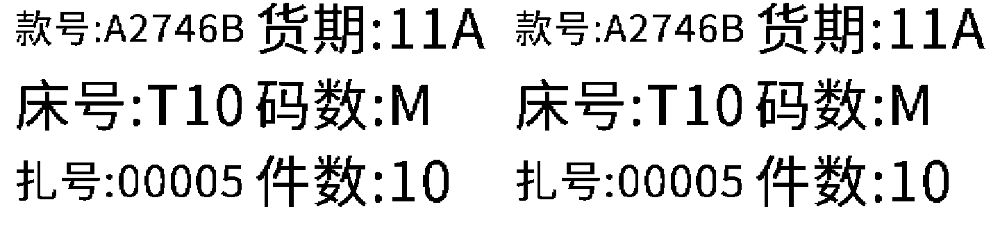
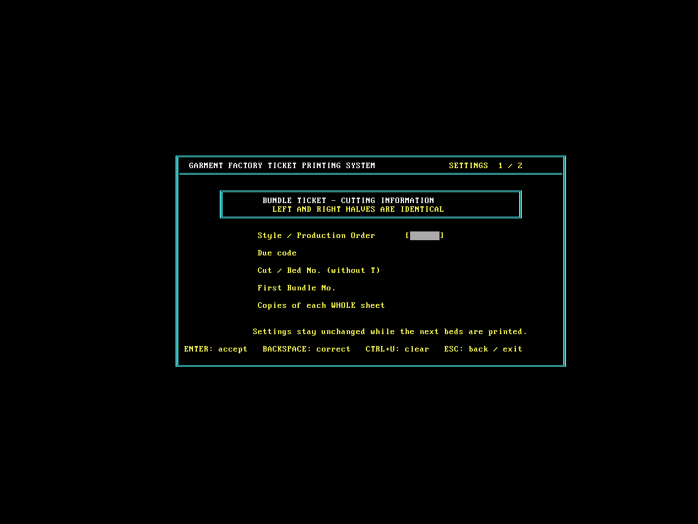
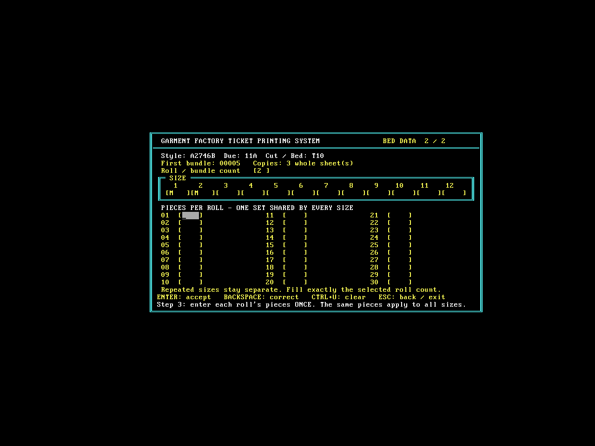

# 菲纸打印程序：旧系统试打版

**[下载最新 v0.2 ZIP](https://github.com/shenlinzia/my-first-project/raw/refs/heads/ticket-download-v0.1/downloads/FEIPRINT-test-v0.2.zip)**

请在原来的旧电脑上解压到新文件夹，先运行 SAMPLE.BAT 打印一张样纸，再运行 START.BAT。默认沿用原有 LPT1 连接。

## v0.2 修改

- 常规细字，整体上移约2.8毫米，收紧行距给底部余量；单张总走纸仍为2英寸。
- 使用双向低数据量点阵，样纸数据减少52.1%；实际打印速度、接缝及边界需实机试打。
- 接近旧软件的画框布局，字母自动大写。
- 第二页先填扎数（最多30），再填尺码（最多12），最后只填一组各扎件数，所有尺码共用。
- 最后一个尺码回车确认后，再空回车表示结束。
- 成功打印后床号加1，扎号回到首页设定的起始号，直接进入下一床第二页。

已在DOS环境完整录入并连续打印两床数据：第一床M/M、2扎、10/12件，4扎44件、3份12张；自动进入T11，扎号回到00005。第二床S、1扎7件，3份3张；再自动进入T12。全部15张左右两半和副本一致。实体LQ-310仍需试打。

### 新样纸数据预览

### 画框界面

ZIP SHA-256: `a9ba17c30cde85817d6f66d4ff4e351f8d8c073d12a0306284af2c036a259823`

[旧版 v0.1](FEIPRINT-test-v0.1.zip) 保留供对照。
